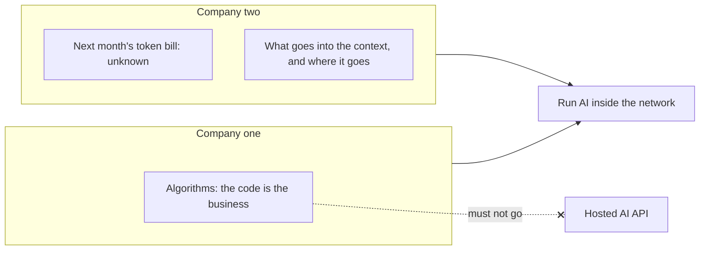
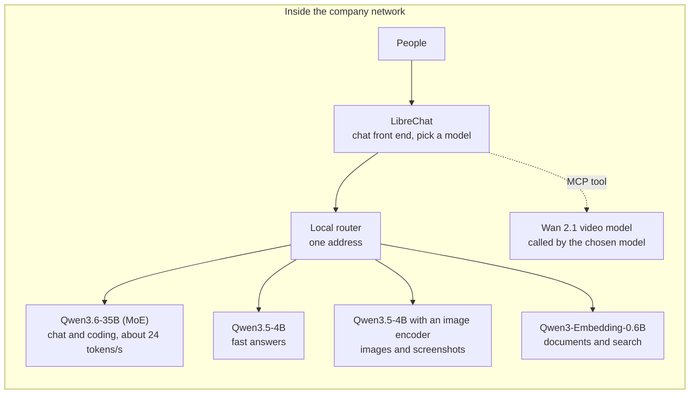
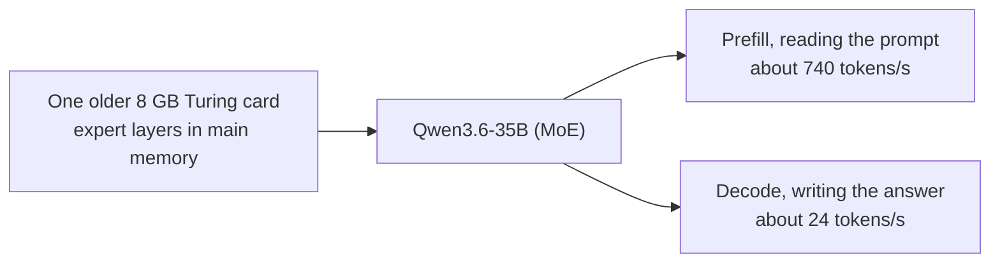
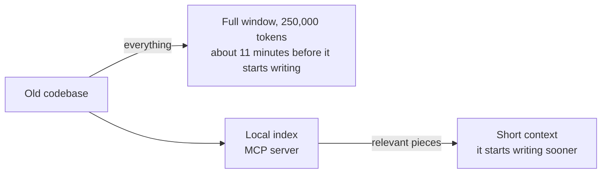
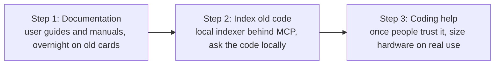
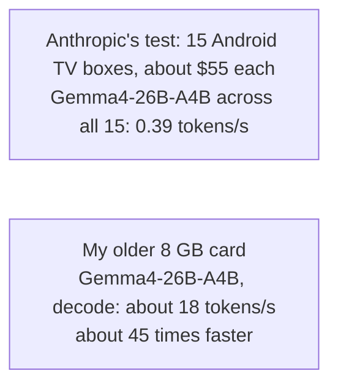
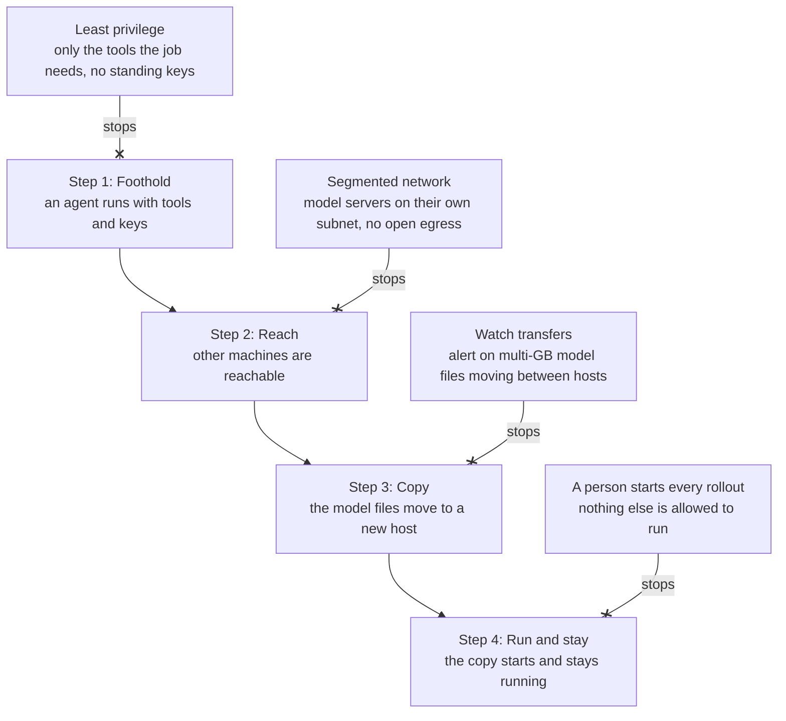

# Running AI inside your own network: what I see so far

In the last few months, two companies asked me the same question: how do we use AI when our data has to stay inside? These are my notes from building an answer on older hardware, and from the people who commented when I first wrote about it on LinkedIn.

## Why companies want it

The first company's algorithms are the core of its business. The company wants its engineers to use AI, and worries about that code ending up somewhere it should not. Its leadership and its IT provider reached the same answer: run it on-prem.

The second company wants to save cost, and to know today what AI will cost next month. Token bills are hard to predict. It also wants control over what goes into the model's context, and where it goes afterwards.

Both told me that stopping AI use is no longer an option. What they want to decide is where it runs.

**Fig. 01 · Two reasons to run it inside.** One company protects its algorithms. The other wants a bill it can predict and control over its context.

## One model per job

I run one model per job, each on a card of its own. Five run side by side:

- Qwen3.6-35B, a mixture-of-experts model, for chat and coding.
- Qwen3.5-4B, a small model for quick answers where speed matters more than depth.
- The same Qwen3.5-4B with an image encoder added, for images and screenshots.
- Qwen3-Embedding-0.6B, an embedding model for documents and search.
- Wan 2.1, a small text-to-video model, for short clips. The quality is poor, and it is slow: in one test a 2-second clip took close to three minutes.

People pick the model for their task in LibreChat, the main front end. Apart from video, the models sit behind one local router on a single address. The router passes each request to the card that serves the model it names. It does not choose a model by itself. The video model is connected as an MCP tool instead, so the model a person has chosen can call it to make a clip. Putting video behind the same address, on its own path, is the next step.

**Fig. 02 · Five models, five cards.** People pick a model in LibreChat, and every card is inside the company network.

None of this runs on new hardware. The cards are Pascal and Turing generation, with 6 or 8 GB of memory each. Qwen3.6-35B runs on a single 8 GB card. Only about 3B of its parameters are active for each token, so its expert layers can sit in the machine's main memory while the card holds the rest. With 8,000 tokens in its context it reads at about 740 tokens per second and writes its answer at about 24. At 100,000 tokens it still reads at about 560. Both rates fall as the context fills up. A year ago I would not have expected that to be fast enough for my own daily work. For focused tasks, it is.

**Fig. 03 · Old card, usable speed.** My own measurements, with 8,000 tokens in the context. Prefill is the model reading the prompt; decode is the model writing the answer.

Two things surprised me. The first is how much the harness matters: the tools, prompts and context around a model change its behaviour as much as the model does. The second is how often a smaller open model is good enough.

I keep testing. When a new model looks promising for the main job, I run it against the one already doing it. Most recently that was Gemma4-26B-A4B against Qwen3.6-35B, on the same card, with the same speed and accuracy tests. Qwen was faster at both reading and writing and just as accurate, so it kept the job.

## What does not work yet

A proof of concept on modest cards shows what is possible, but it will not carry a team's everyday work. That needs more memory and newer cards, and the right size depends on how many people use it and for what. I cannot find that size on my own cards.

Long context is the harder problem, and on this hardware it is mostly a problem of time. Qwen3.6-35B can take 250,000 tokens on the 8 GB card. I hid three values in real source code and asked for all of them, once at each length, and it found all three at 100,000, 200,000 and 250,000 tokens. But it reads everything before it starts writing: about three minutes at 100,000 tokens, and about eleven at 250,000. Whether it can reason across a window that full is still untested.

To keep the context short, I built a local code indexer and serve it to the model as an MCP server. It uses Zoekt, the open-source code search engine maintained by Sourcegraph, and Universal Ctags for symbols. The model gets the relevant pieces of a codebase instead of all of it. In my tests on nine codebases it finds the key files about three times in four. I have not yet measured whether that makes the answers better.

**Fig. 04 · The long-context problem.** A full window fits, but on one 8 GB card the model reads for about 11 minutes before it starts writing. The index sends only the relevant pieces.

Working from retrieved code, the model sometimes went beyond the evidence. I made the instructions explicit: if the supplied code does not answer the question, say "unknown" rather than guessing. I also broke the work into smaller tasks and checked its claims against the source. This produced more usable answers, though I cannot yet say whether it reliably reduces made-up claims.

Anything across a whole codebase is still too slow on this hardware.

## Where I would start

If a company asked me where to begin, I would start with documentation and leave coding assistants for later.

Most companies have user guides, manuals and internal docs that are out of date or missing. Writing and updating them suits a local model, because speed hardly matters. The job can run overnight or over a weekend, and someone reviews the result in the morning.

Next, I would index old codebases locally. Many teams have code that only a few people still understand. A local index lets anyone ask questions about it without sending it anywhere, and it builds trust in the setup before anyone uses it to write new code.

By then you know what people actually use it for, and you can size the hardware on real use instead of a guess.

**Fig. 05 · Start where slow is fine.** Each step builds trust before coding help needs better hardware.

## What the comments added

I expected a few likes when I posted about this on LinkedIn. Instead it drew more than 20 comments, many from people who work on this every day. They taught me more than the post did.

**Rent before you buy.** One commenter rents bare-metal GPU clusters by the hour to benchmark before buying anything: the whole test in one script, spin up, run, shut down, for a few dollars an hour on high-end datacenter GPUs. They have had the best luck with spot instances. That is a cheap way to find the size my own cards cannot show me.

**Small hardware is further along than I thought.** Another commenter runs a mid-sized open model on a small edge computer and finds that it works reasonably well. In their view, compact AI machines are not a big cost, even though they are slow next to a top-end workstation card.

**Build the wrap.** Someone who builds offline-first systems sees the leverage in what surrounds the model: memory that persists, routing each job to the smallest model that can do it, and knowing what a task will cost before it runs. That matches what I found about the harness.

**Memory that is never rewritten.** The same person described their ledger. Every turn is written in. Predictions are hashed before the outcome exists and scored later. Facts have to earn their place. Nothing is overwritten: a changed fact is added as a new entry, and the old one stays, marked as replaced. For long context, they have had the best results with a small fine-tuned model that has a very long window. I want to try that on my long-context problem.

**Watch the router.** Another commenter raised a point I had missed: if a router picks the model, track how often it sends a task to a model too weak for it. Otherwise retries and corrections eat the savings.

**Dedicated cloud works for some.** Someone pointed out that you can rent dedicated cloud hardware without exposing your intellectual property. The first company I described wants its code to stay in the building.

**Test for leaks yourself.** One person uses Claude and checks for leakage by searching for their own distinctive terms from a clean machine and network. They have found none so far. A search like that can find a leak but cannot prove there is none. I may still borrow it.

**Read the data policy.** After those comments I read GitHub's. [Since 24 April 2026, GitHub Copilot Free, Pro, Pro+ and Max use interaction data for training by default](https://docs.github.com/en/copilot/how-tos/manage-your-account/manage-policies), unless you opt out. Business and Enterprise plans are excluded. As I read it, on every plan the code still leaves your network, under a policy that can change.

Thank you to everyone who took the time to write.

## Self-replication: why the boundary matters more now

On 12 October, Anthropic's Frontier Red Team published research on whether AI models can copy themselves onto cheap hardware and keep running there, without a datacenter. Of the open models they tested, only GLM-5.2 completed the whole chain, and it did so reliably. Small models are not there yet, but the researchers write that they may be months away. The test devices had no authentication on their debug port, which made the break-in step trivial, so the team treats the results as an upper bound on real-world success.

**Table · What they measured.** Results from Anthropic's Frontier Red Team.

| Measured | Result |
| --- | --- |
| GLM-5.2, full replication | 8 of 8 nodes in 4 of 5 trials, 7 of 8 in the fifth |
| Qwen3.5-9B getting inference running | 8 of the 9 hardware types tested |
| Qwen3.5-9B getting inference running, with notes inherited from the previous generation | 45% in the first generation, 61 to 84% in later ones |
| **Gemma4-26B-A4B across 15 Android TV boxes, about $55 each** | **0.39 tokens per second** |
| Time for one Qwen3.5-9B replication | 1 to 2 days |
| When small models reach GLM-5.2's level | By the end of 2026, if the trend holds (on an index the authors call a rough proxy) |

Source: [Anthropic, AI models may be capable of self-replicating without access to a datacenter](https://www.anthropic.com/research/self-replicating-ai), 12 October 2026.

Fig. 06 puts the TV boxes next to my setup, running the same model. My old card writes answers about 45 times faster, though the two numbers are not measured the same way. For a replicator, slow is enough. It has no deadline.

**Fig. 06 · Slow is still usable.** The same model, Gemma4-26B-A4B, on both sides. The TV boxes are from Anthropic's Frontier Red Team, the card is my own setup. Measured differently, shown for scale.

I have built software that copies programs to a fleet of machines and starts them there. Copy and run are two of the steps a self-replicating model needs. In that work the safeguard is the process around the software: every change is tested first, and a person starts each rollout. A self-replicating model takes that person out of the loop.

**Fig. 07 · Where to break the chain.** My own breakdown of the steps a self-replicating model needs, and the control that stops each one. Blocking any one step is enough.

This is why I see private AI and safety as one piece of work. The controls in Fig. 07 that keep your code from leaving also keep a model from spreading. The defences Anthropic proposes sit further out, with internet providers and device makers: network monitoring, honeypots, quarantine of infected devices, and safer defaults. Their aim is to push the replication rate below one, so that an outbreak dies out instead of spreading.

## If you are considering it

If your company wants AI and your data has to stay inside, this is what I would do:

1. Write down which data must stay inside, and why. That decides most of the rest.
2. Pick one job to start with. Documentation is a good first one.
3. Rent GPUs for a few hours and test that job on open models, with data that is safe to send out, before you buy hardware.
4. Give each job the smallest model that does it well, with one front end for all of them.
5. Next, index your own code and documents locally, so people can ask questions about them.
6. Add coding help once people trust the setup, and size the hardware on real use.
7. Keep model servers on their own network segment, and have a person start anything that copies or runs models on other machines.

This is the work I do at Yantrakar. Some clients want consulting hours and some want an end-to-end service, and I price the work on what it needs. To talk about your setup, use the [contact form](https://yantrakar.com/running-ai-inside-your-network.html#contact) or find me on [LinkedIn](https://www.linkedin.com/in/sandeepshelke/). More on how I work is on the [Private AI](https://yantrakar.com/private-ai.html) page.
