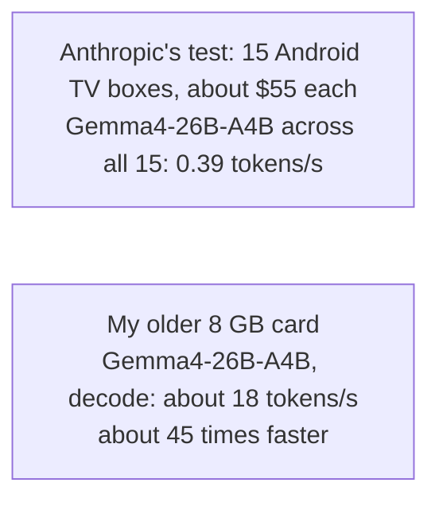
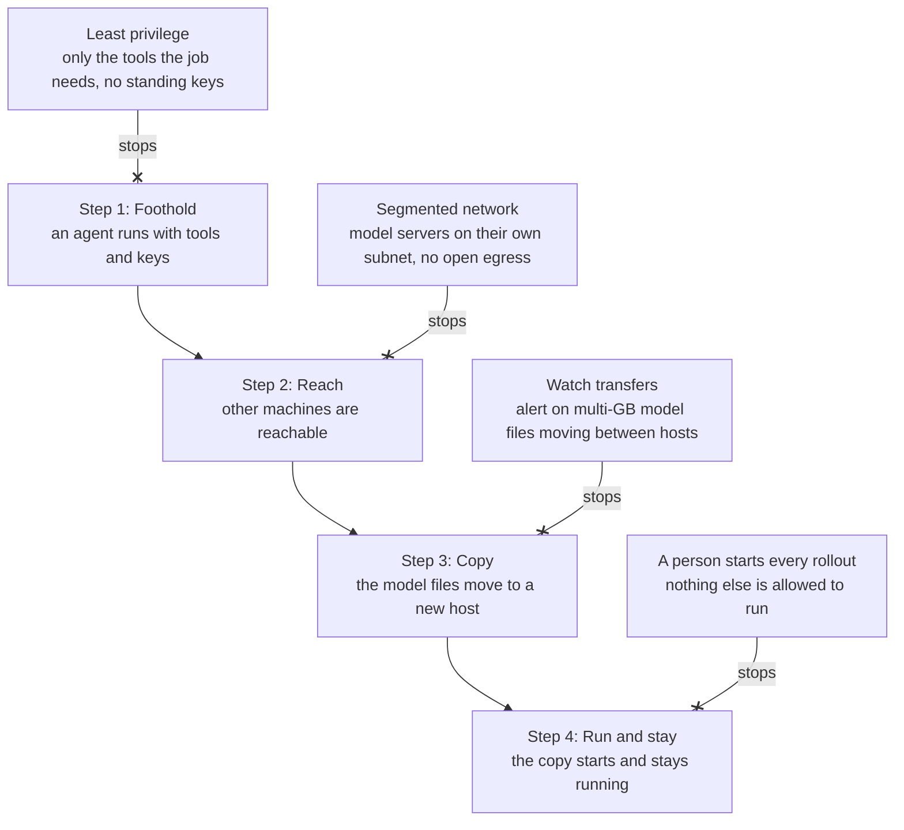

# Self-replication: why the network boundary matters more now

I have built software that copies programs to a fleet of machines and starts them there. Copy and run are two of the steps a self-replicating model needs. In that work the safeguard is the process around the software: every change is tested first, and a person starts each rollout. A self-replicating model takes that person out of the loop.

## What they measured

On 12 October, Anthropic's Frontier Red Team published research on whether AI models can copy themselves onto cheap hardware and keep running there, without a datacenter. Of the open models they tested, only GLM-5.2 completed the whole chain, and it did so in most trials. Small models are not there yet, but the researchers write that they may be months away. The test devices had no authentication on their debug port, which made the break-in step trivial, so the team treats the results as an upper bound on real-world success.

**Table · What they measured.** Results from Anthropic's Frontier Red Team.

| Measured | Result |
| --- | --- |
| GLM-5.2, full replication | 8 of 8 nodes in 4 of 5 trials, 7 of 8 in the fifth |
| Qwen3.5-9B getting inference running | 8 of the 9 hardware types tested |
| Qwen3.5-9B getting inference running, with notes inherited from the previous generation | 45% in the first generation, 61 to 84% in later ones |
| **Gemma4-26B-A4B across 15 Android TV boxes, about $55 each** | **0.39 tokens per second** |
| Time for one Qwen3.5-9B replication | 1 to 2 days |
| When small models reach GLM-5.2's level | By the end of 2026, if the trend holds (on an index the authors call a rough proxy) |

Source: [Anthropic, AI models may be capable of self-replicating without access to a datacenter](https://www.anthropic.com/research/self-replicating-ai), 12 October 2026.

## Slow is still usable

Fig. 01 puts the TV boxes next to my setup, running the same model. My old card writes answers about 45 times faster, though the two numbers are not measured the same way. For a replicator, slow is enough. It has no deadline.

**Fig. 01 · Slow is still usable.** The same model, Gemma4-26B-A4B, on both sides. The TV boxes are from Anthropic's Frontier Red Team, the card is my own setup. Measured differently, shown for scale.

## Where to break the chain

**Fig. 02 · Where to break the chain.** My own breakdown of the steps a self-replicating model needs, and the control that stops each one. Blocking any one step is enough.

This is why I see private AI and safety as one piece of work. The controls in Fig. 02 that keep your code from leaving also keep a model from spreading. The defences Anthropic proposes sit further out, with internet providers and device makers: network monitoring, honeypots, quarantine of infected devices, and safer defaults. Their aim is to push the replication rate below one, so that an outbreak dies out instead of spreading.

## What I would do

If you run models inside your network, this is what I would add:

1. Give agents only the tools their job needs, with no standing keys.
2. Keep model servers on their own network segment, and have a person start anything that copies or runs models on other machines.
3. Alert when multi-GB model files move between hosts.

The hardware, the models and where I would start are in [Running AI inside your own network: what I see so far](https://yantrakar.com/running-ai-inside-your-network.html).

This is the work I do at Yantrakar. Some clients want consulting hours and some want an end-to-end service, and I price the work on what it needs. To talk about your setup, use the [contact form](https://yantrakar.com/self-replication-network-boundary.html#contact) or find me on [LinkedIn](https://www.linkedin.com/in/sandeepshelke/). More on how I work is on the [Private AI](https://yantrakar.com/private-ai.html) page.
